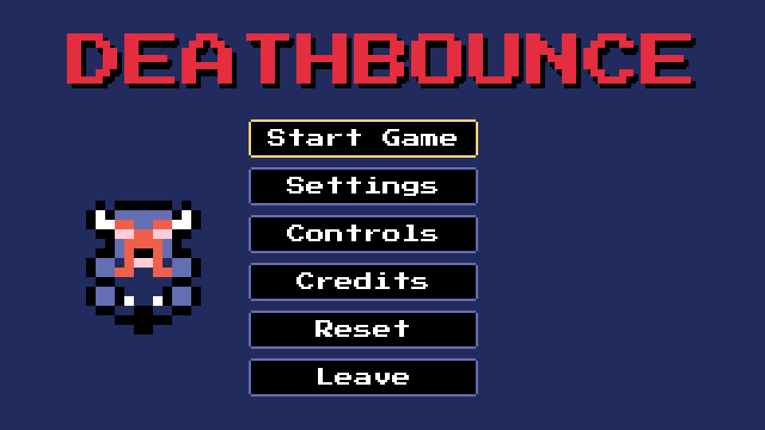
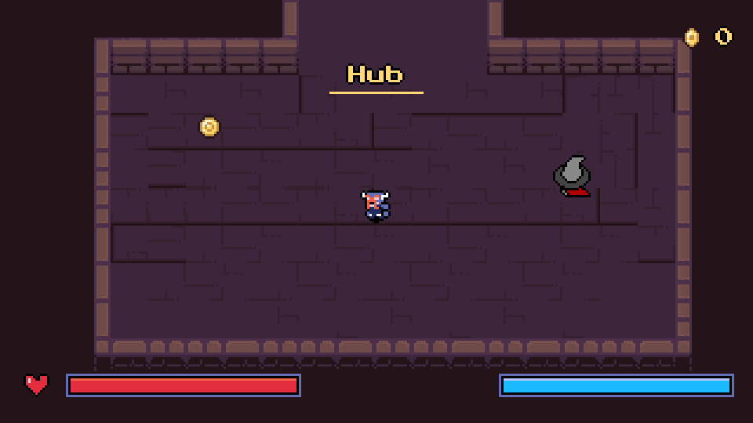
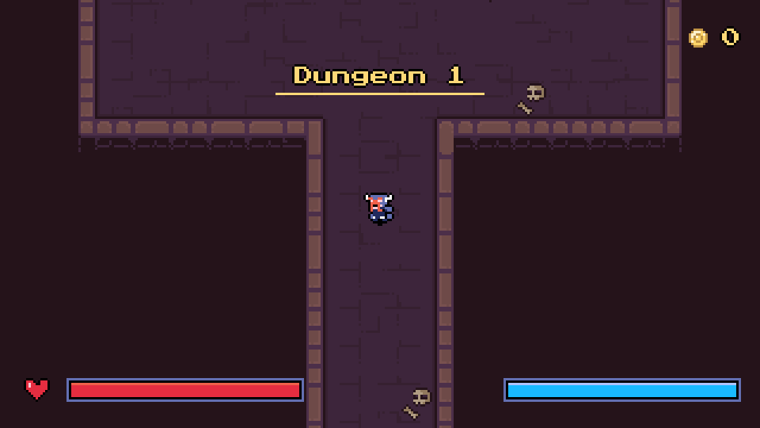
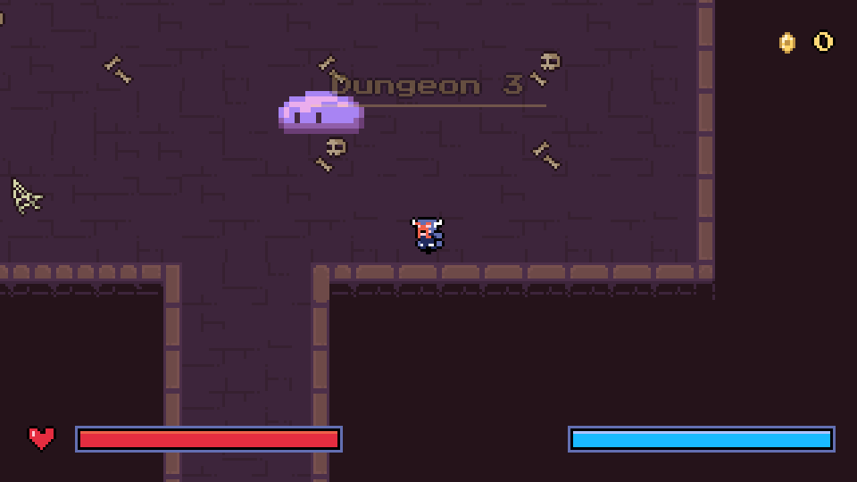

# DeathBounce

A top-down dungeon crawler made for **Hack Club Haven 2026**.

**Play it:** https://deathbounce.web.app/

## How to play

Start in the hub, head into the dungeon, fight through three rooms and beat the boss slime in the last one. Collect coins and spend them at the shopkeeper in the hub on upgrades.

| Action   | Keys          |
| -------- | ------------- |
| Move     | WASD / Arrows |
| Attack   | F             |
| Dash     | Left Shift    |
| Interact | E / Enter     |
| Pause    | Esc           |

You can also use your phone as a controller: scan the QR code shown on the game screen, or enter the code at https://deathbounce.web.app/controller.html.

## Screenshots

## Team

- Sarvin Sukhe
- Reid Henderson
- Sarvesh Raman

## Credits

- Art: Trevor Pupkin
- Slimes: Pixelsnorf (CC BY 4.0)
- Audio: Juhani Junkala (CC0)
- Font: Press Start 2P (OFL)
- Built with Godot 4
